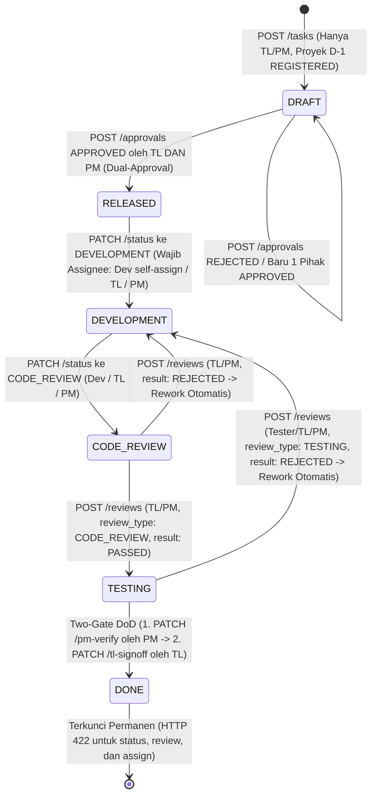
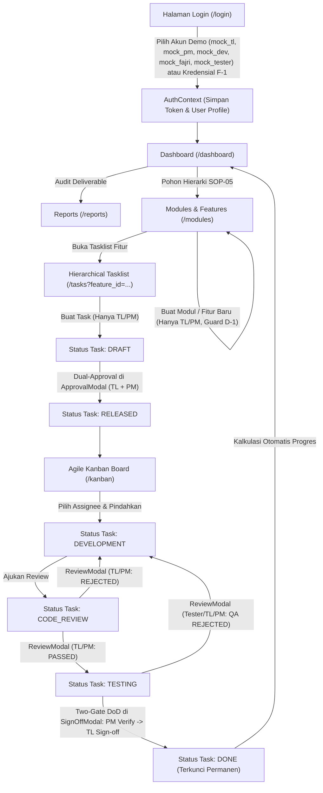
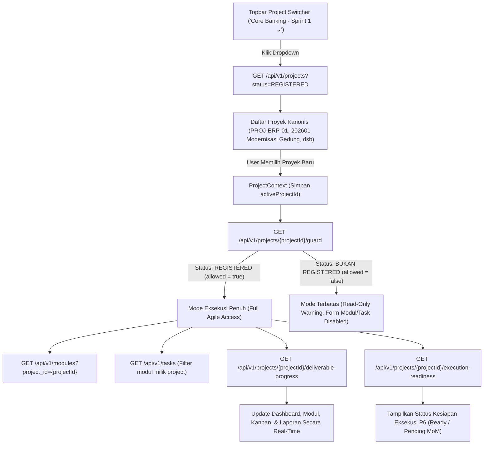

# Product Requirements Document (PRD): Frontend Aplikasi ERP Tasklist Agile (Modul K-04 / E-4)

| Metadata | Detail |
| :--- | :--- |
| **Document ID** | `PRD-ERP-K04-FE-v2.2` |
| **Status** | `Approved & Synchronized — Sinkronisasi Penuh State Backend (Terminal DONE, Strict Role Guards, D-1 Project Switcher & Guard, E-3 Execution Readiness, & OpenAPI Alignment)` |
| **Owner** | Tim Frontend & Backend ERP Tasklist Agile (Kelompok 4 / Kelas E) |
| **Dokumen Referensi** | `docs/spesifikasi_fitur_minimum_4_e.md`, `docs/api_documentation.md`, `docs/openapi.yaml`, `docs/ERP_Modul_E4_Postman_Collection.json`, `backend/tests/Feature/TaskBugFixesTest.php`, `backend/tests/Feature/TaskAgileExecutionTest.php`, `backend/tests/Feature/ExternalIntegrationTest.php` |
| **Target Environment** | React + Vite + TypeScript (Frontend), Laravel REST API `v1` (`https://168-110-206-131.sslip.io/api/v1` & `http://127.0.0.1:8001/api/v1`) |

---

## 1. Executive Summary & Problem Statement

### 1.1 Konteks Produk
Aplikasi Frontend **ERP Tasklist Agile (Modul K-04 / E-4)** adalah antarmuka eksekusi agile berbasis hierarki *Module -> Feature (opsional) -> Task* yang mengawal siklus hidup pekerjaan dari tahap `DRAFT` hingga status akhir `DONE`. Sistem mengimplementasikan tata kelola ketat:
- **Dual-Approval Task Release Gate (FTR-K04-03):** Persetujuan independen terpisah oleh `TECHNICAL_LEAD` dan `PROJECT_MANAGER` sebelum tugas dapat dikerjakan.
- **Agile Kanban Board 5 Kolom (FTR-K04-04):** `RELEASED` &rarr; `DEVELOPMENT` &rarr; `CODE_REVIEW` &rarr; `TESTING` &rarr; `DONE` dengan validasi pelaksana (*assignee*).
- **Pencatatan Review, QA Testing, & Otomasi Alur Rework (FTR-K04-05):** Pengembalian otomatis tugas gagal uji (`REJECTED`) ke kolom `DEVELOPMENT` beserta pencatatan log audit.
- **Two-Gate Definition of Done (FTR-K04-06):** Verifikasi ceklis fungsional oleh Project Manager (`is_pm_verified = true`) diikuti otorisasi pengesahan akhir oleh Technical Lead (`is_tl_signed = true`).
- **Mesin Kalkulasi Progres Deliverable (FTR-K04-07 & API-K04-01):** Akumulasi matematis rasio jam kerja (*man-hour*) tugas selesai terhadap total beban deliverable proyek/modul.
- **Integrasi Modul D-1 Project Switcher (FTR-K04-11):** Penukaran dinamis konteks proyek aktif (`GET /projects` & `GET /projects/{projectId}`) dengan sinkronisasi otomatis modul, sprint tasklist, dan rasio deliverable.
- **Validasi Guard Proyek D-1 (FTR-K04-12):** Pemeriksaan pra-syarat eksekusi agile (`GET /projects/{projectId}/guard`) untuk memastikan proyek berstatus `REGISTERED` sebelum modul/tugas dapat dibuat atau dieksekusi.
- **Integrasi Modul E-3 Execution Readiness P6 (FTR-K04-13):** Validasi kesiapan eksekusi proyek berbasis MoM & Kickoff Meeting sebelum eksekusi kanban intensif (`GET /projects/{projectId}/execution-readiness`).

### 1.2 State Terkini Backend (Pasca Bug Fixes PR #7 & Integrasi Eksternal PR #9)
Backend telah memperbarui dan memvalidasi seluruh aturan bisnis melalui 29 unit/feature tests (`TaskBugFixesTest` dan `TaskAgileExecutionTest`) serta suite `ExternalIntegrationTest`. Aturan ketat yang saat ini aktif di backend:
1. **Terminal DONE Immutability:** Tugas berstatus `DONE` terkunci permanen. Segala upaya memindahkan status (`PATCH /status`), menguji/mereview ulang (`POST /reviews`), atau mengubah PIC (`PATCH /assign`) ditolak dengan **HTTP 422 Unprocessable Content**.
2. **Strict Role-Based Transitions & Reviews:**
   - Peran `DEVELOPER` **hanya berwenang** menarik dari `RELEASED -> DEVELOPMENT` (dengan menugaskan diri sendiri) dan memajukan dari `DEVELOPMENT -> CODE_REVIEW`. Developer **dilarang keras** mengubah status kartu di `CODE_REVIEW` atau `TESTING`, memindahkan ke `DONE` secara langsung, atau submit review (`POST /reviews`) (**HTTP 403 Forbidden**).
   - Peran `TESTER` **dilarang melakukan drag-and-drop manual** kolom via `PATCH /status` (**HTTP 403 Forbidden**); pengujian wajib melalui `POST /tasks/{id}/reviews`.
   - Peran `TECHNICAL_LEAD` & `PROJECT_MANAGER` memegang wewenang penuh atas review `CODE_REVIEW` dan pengesahan awal.
3. **Guard Pembuatan Modul & Tugas (D-1 Project Guard):** Pembuatan Modul, Fitur, dan Tugas hanya boleh dilakukan oleh `TECHNICAL_LEAD` atau `PROJECT_MANAGER` (**HTTP 403** jika Developer/Tester) dan proyek terkait wajib berstatus `REGISTERED` pada Modul D-1 (**HTTP 422**).
4. **Guard Penetapan PIC (`PATCH /tasks/{id}/assign`):** Tugas `DRAFT` belum boleh di-assign sebelum dirilis via Dual-Approval (**HTTP 422**); tugas `DONE` tidak boleh di-assign ulang (**HTTP 422**); Developer hanya boleh *self-assign* (**HTTP 403** jika meng-assign orang lain); Tester dilarang meng-assign (**HTTP 403**).
5. **Serialisasi Eloquent & Kontrak Field OpenAPI:** Relasi review log diserialisasi sebagai `review_logs` dengan field `review_type` (bukan `stage`), `result`, `reviewer_id`, `reviewer_name`, `notes`, `created_at` (bukan `reviewed_at`); approval memakai `role`, `status`, `actioned_at`; jam kerja menggunakan `actual_man_hours` dan `estimated_man_hours`.
6. **Project Switcher & Enriched Project Details (PR #9):** Penambahan endpoint `GET /projects` dan pemutakhiran `GET /projects/{projectId}` yang menggabungkan proyek kanonis D-1 (`202601`, `202602`) dan canonical internal E-4 (`PROJ-ERP-01`) lengkap dengan query filter `status`, `q`, pagination `meta`, serta metrik `moduleCount` dan `taskCount`.
7. **Execution Readiness Gate (Modul E-3):** Endpoint `GET /projects/{projectId}/execution-readiness` memverifikasi status kelengkapan kick-off meeting dan MoM untuk memenuhi kepatuhan prioritas P6.

### 1.3 Target Metrik Keberhasilan Frontend (Measurable KPI)
- **0% Transisi Ilegal di UI:** 100% aksi ilegal di Kanban dicegah di level antarmuka sebelum request dikirim (kartu `DONE` `draggable={false}`, dropzone terlarang dinonaktifkan, aksi sesuai peran pengguna aktif).
- **100% Keselarasan Kontrak API & Zero Unhandled 403/422:** Seluruh interaksi form, modal, dan hook menangani pesan error spesifik dari backend (menampilkan toast/alert informatif alih-alih crash atau unhandled rejection).
- **100% Dukungan Multi-Akun Simulasi:** Mendukung penuh 5 akun demo F-1 (`mock_tl`, `mock_pm`, `mock_dev`, `mock_fajri`, `mock_tester`) dengan pemilihan berbasis `token` unik tanpa bentrok role.
- **100% Audit Log Review Tercatat:** Transisi `CODE_REVIEW -> TESTING` dan penolakan rework (`-> DEVELOPMENT`) selalu melewati `POST /tasks/{id}/reviews`.

---

## 2. User Personas & Permissions Matrix

Sistem mengenali 4 peran (*role*) dan 5 akun demo terverifikasi pada backend (`AuthController.php` & `docs/api_documentation.md`):

| Persona / Role | Akun Demo Aktif | Bearer Token & UUID | Wewenang Diizinkan | Batasan Kritis (Backend Guard) |
| :--- | :--- | :--- | :--- | :--- |
| **TECHNICAL_LEAD (TL)** | Fauzan (Technical Lead) | `mock_tl`<br>`01926df4-0001-7000-8000-000000000001` | - Membuat Modul, Fitur, dan Task (dengan D-1 guard)<br>- Dual-Approval Task Release (`APPROVED`/`REJECTED`)<br>- Submit Code Review & QA Review<br>- Assign PIC bebas ke developer manapun<br>- **Satu-satunya peran berwenang memberikan TL Final Sign-off (`DONE`)** | Wajib menunggu verifikasi PM (`is_pm_verified === true`) sebelum mengeksekusi sign-off `DONE` (HTTP 422 jika dilanggar). |
| **PROJECT_MANAGER (PM)** | Tubagus M. Wildan (Project Manager) | `mock_pm`<br>`01926df4-0002-7000-8000-000000000002` | - Membuat Modul, Fitur, dan Task (dengan D-1 guard)<br>- Dual-Approval Task Release (`APPROVED`/`REJECTED`)<br>- Submit Code Review & QA Review<br>- Assign PIC bebas ke developer manapun<br>- **Gerbang 1: Melakukan PM Checklist Verification (`is_pm_verified`)**<br>- Memantau Dashboard & Report Deliverable | Dilarang mengeksekusi final sign-off penutupan `DONE` (HTTP 403 Forbidden; hak eksklusif TL). |
| **DEVELOPER (DEV)** | 1. Ariel (Frontend Dev)<br>2. Muhamad Fajri (Backend Dev) | `mock_dev`<br>`01926df4-0003-7000-8000-000000000003`<br><br>`mock_fajri`<br>`01926df4-0005-7000-8000-000000000005` | - Menarik tugas `RELEASED -> DEVELOPMENT`<br>- Self-assign PIC (`assignee_id === auth_user.id`)<br>- Memajukan tugas `DEVELOPMENT -> CODE_REVIEW` | - Dilarang membuat Modul, Fitur, atau Task (HTTP 403)<br>- Dilarang memindahkan tugas yang sedang di `CODE_REVIEW` atau `TESTING` (HTTP 403)<br>- Dilarang memindahkan status langsung ke `DONE` (HTTP 403)<br>- Dilarang submit review/testing (HTTP 403)<br>- Dilarang menugaskan developer lain (HTTP 403)<br>- Dilarang assign pada `DRAFT` atau `DONE` (HTTP 422) |
| **TESTER (QA)** | Valdric (QA Tester) | `mock_tester`<br>`01926df4-0004-7000-8000-000000000004` | - Menjalankan pengujian tugas di kolom `TESTING`<br>- Submit review `POST /tasks/{id}/reviews` (`review_type: "TESTING"`, `result: "PASSED"` atau `"REJECTED"`)<br>- Melihat riwayat review logs | - Dilarang drag-and-drop manual status via `PATCH /status` (HTTP 403)<br>- Dilarang assign PIC (HTTP 403)<br>- Dilarang membuat Modul/Fitur/Task (HTTP 403)<br>- Dilarang melakukan verifikasi PM atau sign-off TL (HTTP 403) |

---

## 3. Business Flows & System Logic

### 3.1 State Machine Siklus Hidup Tugas (Finite State Machine)

Setiap tugas mengikuti diagram status resmi di bawah. Status `DONE` bersifat **terminal (terkunci permanen)** dan tidak dapat dipindahkan kembali ke fase manapun.



### 3.2 Matriks Validasi Transisi Kanban (Allowed vs Forbidden & Role Guard)

| Dari Status (`from`) | Ke Status (`to`) | Status Aturan | Peran Diizinkan | Mekanisme & Respons Backend |
| :--- | :--- | :--- | :--- | :--- |
| `DRAFT` | `RELEASED` | **DIIZINKAN (Khusus)** | `TECHNICAL_LEAD`, `PROJECT_MANAGER` | Melalui **Approval Modal** (`POST /tasks/{id}/approvals`). Kedua pihak wajib `APPROVED`. Drag langsung di Kanban dilarang (HTTP 422). |
| `DRAFT` | `DEVELOPMENT` s.d. `DONE` | **DILARANG** | - | Ditolak sebelum melewati rilis resmi Dual-Approval. |
| `RELEASED` | `DEVELOPMENT` | **DIIZINKAN** | `DEVELOPER`, `TECHNICAL_LEAD`, `PROJECT_MANAGER` | Wajib menyertakan `assignee_id`. Developer hanya boleh *self-assign* (HTTP 403 jika menugaskan orang lain). Jika assignee kosong, sistem mengembalikan HTTP 422. |
| `RELEASED` | `CODE_REVIEW` / `TESTING` / `DONE` | **DILARANG** | - | Dilarang melompati tahap `DEVELOPMENT`. |
| `DEVELOPMENT` | `CODE_REVIEW` | **DIIZINKAN** | `DEVELOPER`, `TECHNICAL_LEAD`, `PROJECT_MANAGER` | Dipicu via tombol aksi `"Ajukan Review"` atau drag ke kolom `CODE_REVIEW` (`PATCH /tasks/{id}/status`). |
| `DEVELOPMENT` | `RELEASED` / `TESTING` / `DONE` | **DILARANG** | - | Dilarang melompati `CODE_REVIEW` atau mundur manual ke `RELEASED`. |
| `CODE_REVIEW` | `TESTING` | **DIIZINKAN (Via Review)** | `TECHNICAL_LEAD`, `PROJECT_MANAGER` | Wajib melalui **Review Modal** (`POST /tasks/{id}/reviews`, `review_type: "CODE_REVIEW"`, `result: "PASSED"`). Backend otomatis memajukan status ke `TESTING`. Developer dilarang (HTTP 403). |
| `CODE_REVIEW` | `DEVELOPMENT` | **DIIZINKAN (Via Rework)** | `TECHNICAL_LEAD`, `PROJECT_MANAGER` | Wajib melalui **Review Modal** (`POST /tasks/{id}/reviews`, `result: "REJECTED"`, notes wajib). Backend otomatis mengembalikan status ke `DEVELOPMENT` dan mencatat log revisi. |
| `CODE_REVIEW` | `RELEASED` / `DONE` | **DILARANG** | - | Dilarang melompati `TESTING`. |
| `TESTING` | `DEVELOPMENT` | **DIIZINKAN (Via Rework)** | `TESTER`, `TECHNICAL_LEAD`, `PROJECT_MANAGER` | Wajib melalui **Review Modal** (`POST /tasks/{id}/reviews`, `review_type: "TESTING"`, `result: "REJECTED"`). Backend otomatis mengembalikan status ke `DEVELOPMENT`. Developer dilarang (HTTP 403). |
| `TESTING` | `DONE` | **DIIZINKAN (Two-Gate DoD)** | Gerbang 1: `PROJECT_MANAGER`<br>Gerbang 2: `TECHNICAL_LEAD` | Wajib memenuhi dua tahap: 1. `PATCH /pm-verify` (`is_pm_verified = true`), 2. `PATCH /tl-signoff` atau `/sign-off-done` (`is_tl_signed = true`). TL tidak bisa sign-off sebelum PM verify (HTTP 422). Peran lain ditolak HTTP 403. |
| `DONE` | **Status Mana Pun** | **DILARANG KERAS (Terminal)** | - | Kartu `DONE` non-draggable. Upaya apa pun mengubah status menghasilkan **HTTP 422 Unprocessable Content** (*"Tugas yang telah berstatus DONE bersifat final dan tidak dapat diubah kembali ke fase lain."*). |

### 3.3 Alur End-to-End Interaksi Pengguna di Frontend



### 3.4 Alur Project Switcher & Context Filtering (Modul D-1 & E-3)



---

## 4. Scope Definition (In-Scope vs Non-Goals)

### In-Scope (Fokus Rilis & Sinkronisasi FE)
1. **Penegakan Aturan State Machine Kanban Board (`/kanban`):**
   - Mengunci kartu `DONE` (`draggable={false}`, visual locked/archived).
   - Penolakan transisi ilegal per peran pengguna (misal Developer dilarang drag kartu di `CODE_REVIEW`/`TESTING`; Tester dilarang drag langsung).
   - Dropzone visual feedback: Hanya kolom target yang valid yang menyala saat *dragging*.
   - Intersepsi aksi review: Transisi ke `TESTING` atau rework ke `DEVELOPMENT` wajib membuka modal review dan mengirim `POST /tasks/{id}/reviews`.
2. **Sinkronisasi Multi-Akun Simulasi F-1:**
   - Memperbaiki `RoleSelector` dan `useLoginForm` agar memilih akun berbasis `token` unik (`mock_tl`, `mock_pm`, `mock_dev`, `mock_fajri`, `mock_tester`), mengatasi bentrok role antara `mock_dev` dan `mock_fajri`.
   - Menambahkan Muhamad Fajri (Backend Dev) ke daftar developer di `AssigneeModal` dan `DEMO_DEVELOPERS`.
3. **Penyelarasan Kontrak Data & Zod Schema dengan Backend & OpenAPI:**
   - `TaskReviewLog`: Menggunakan properti `review_type` (bukan `stage`), `result`, `reviewer_id`, `reviewer_name`, `notes`, `created_at` (bukan `reviewed_at`).
   - `TaskApproval`: Menggunakan properti `role`, `status`, `approver_id`, `approver_name`, `notes`, `actioned_at`.
   - `Task`: Menggunakan `actual_man_hours`, `estimated_man_hours`, `review_logs` (snake_case), `approvals`.
   - Deteksi rework yang akurat: `task.status === "DEVELOPMENT" && task.review_logs?.some(l => l.result === "REJECTED")`.
4. **Integrasi Endpoint & Penanganan Guard Backend:**
   - Menghubungkan `PATCH /tasks/{id}/assign` dengan validasi peran (Dev hanya self-assign, TL/PM bebas, Tester diblokir).
   - Menangani guard pembuatan Modul/Fitur/Task (hanya TL/PM yang dapat melihat tombol buat; menampilkan pesan error jika proyek D-1 belum `REGISTERED`).
   - Menangani pesan error spesifik dari backend (HTTP 403 & 422) secara elegan melalui toast notification.
5. **Two-Gate DoD Modal (`SignOffModal`):**
   - Menampilkan status Gerbang 1 (PM Verification) dan Gerbang 2 (TL Sign-off).
   - Menonaktifkan tombol TL sign-off jika PM belum melakukan verifikasi, dan hanya menampilkan tombol aksi sesuai role yang sedang login.
6. **Integrasi Modul D-1 Project Switcher & E-3 Execution Readiness (PR #9):**
   - Menghubungkan dropdown proyek pada `Topbar.tsx` ke endpoint `GET /projects` dan `GET /projects/{projectId}`.
   - Mengelola active `projectId` (default: `PROJ-ERP-01`) agar modul, hierarki tugas, dan deliverable progress berganti secara dinamis saat proyek dialihkan.
   - Menampilkan badge kesiapan eksekusi agile dari Modul E-3 (`GET /projects/{projectId}/execution-readiness`).

### Non-Goals (Di Luar Ruang Lingkup)
1. **Membuka Kembali Task `DONE` (Reopening):** Task `DONE` bersifat final dan tidak dapat dibuka kembali. Jika ada bug lanjutan pasca rilis, tim wajib membuat task baru (*bugfix task*).
2. **WebSocket / Real-time Push:** Sinkronisasi antar pengguna tetap mengandalkan invalidasi cache React Query pada setiap mutasi dan opsi polling/refetch berkala.
3. **Manajemen User Admin / CRUD User:** Penambahan user dan pengaturan hak akses dikelola oleh Modul F-1 eksternal; FE hanya mengonsumsi token atau endpoint login F-1.

---

## 5. Functional Requirements & Acceptance Criteria Table

Setiap kebutuhan diverifikasi melalui kriteria *Given-When-Then* berikut:

| Req ID | Fitur / Kebutuhan | Kriteria Penerimaan (Given - When - Then) | Status Audit BE |
| :--- | :--- | :--- | :--- |
| **REQ-01** | **Terminal DONE Immutability** | **Given** task berstatus `DONE`, **When** user mencoba mendrag kartu di Kanban, mengubah PIC, atau mereview ulang, **Then** kartu tidak *draggable* (`draggable={false}`), tombol aksi di disabled, dan jika API dipanggil akan menerima HTTP 422: *"Tugas yang telah berstatus DONE bersifat final..."*. | Verified BE (Test Bug 1) |
| **REQ-02** | **Role-Based Drag & Transition Guard di Kanban** | **Given** user login sebagai `DEVELOPER`, **When** mencoba memindahkan kartu yang sedang di `CODE_REVIEW` / `TESTING` atau menarik langsung ke `DONE`, **Then** UI memblokir drag untuk kartu tersebut dan dropzone target tidak aktif. Jika lolos ke API, server merespon HTTP 403. | Verified BE (Test Bug 2) |
| **REQ-03** | **Tester Forbidden Drag Kanban** | **Given** user login sebagai `TESTER`, **When** membuka `/kanban`, **Then** seluruh kartu tidak memiliki aksi drag ke status lain; transisi pengujian hanya dapat dilakukan via Review Modal / Halaman Reviews. Server mengembalikan HTTP 403 jika Tester memanggil `PATCH /status`. | Verified BE (Test Bug 2) |
| **REQ-04** | **Pencatatan Audit Review & Otomasi Rework** | **Given** task berada di `CODE_REVIEW` atau `TESTING`, **When** reviewer/tester menolak hasil uji (`result: "REJECTED"`), **Then** request dikirim via `POST /tasks/{id}/reviews`, backend otomatis mengembalikan status ke `DEVELOPMENT`, dan kartu di Kanban menampilkan label `REWORK`. Developer ditolak HTTP 403 jika mencoba submit review. | Verified BE (Test Bug 2) |
| **REQ-05** | **Wajib Assignee & Self-Assign Guard** | **Given** task berstatus `RELEASED`, **When** ditarik ke `DEVELOPMENT`, **Then** modal penugasan PIC muncul jika belum ada assignee. Jika user adalah Developer, pilihan hanya dirinya sendiri (self-assign); jika TL/PM, dapat memilih seluruh developer (termasuk Fajri). Tugas `DRAFT` dan `DONE` dilarang di-assign (HTTP 422). | Verified BE (Test Bug 3) |
| **REQ-06** | **Role Guard Pembuatan Modul, Fitur, & Task** | **Given** user login sebagai `DEVELOPER` atau `TESTER`, **When** membuka `/modules` atau `/tasks`, **Then** tombol `"Tambah Modul"`, `"Tambah Fitur"`, dan `"Tambah Tugas"` disembunyikan/dinonaktifkan. Pemanggilan API oleh non-TL/PM mengembalikan HTTP 403. | Verified BE (Test Bug 3) |
| **REQ-07** | **Guard Kesiapan Proyek D-1 (Status REGISTERED)** | **Given** modul terkait berada pada proyek yang belum berstatus `REGISTERED` di Modul D-1, **When** TL/PM mencoba membuat tugas baru, **Then** server mengembalikan HTTP 422 dengan kode `PROJECT_NOT_REGISTERED`, dan FE menampilkan pesan peringatan yang jelas kepada pengguna. | Verified BE (D-1 Guard) |
| **REQ-08** | **Mekanisme Dual-Approval Task Release** | **Given** tugas baru berstatus `DRAFT`, **When** TL dan PM menyetujui secara terpisah di `ApprovalModal`, **Then** status tugas tetap `DRAFT` hingga kedua pihak menyetujui (`APPROVED`), dan otomatis beralih ke `RELEASED` setelah approval kedua masuk. | Verified BE (Test 2 Agile) |
| **REQ-09** | **Two-Gate Definition of Done (`TESTING -> DONE`)** | **Given** tugas berada di `TESTING`, **When** PM mengisi ceklis verifikasi (`is_pm_verified = true`), **Then** tombol sign-off TL menjadi aktif. Ketika TL mengeksekusi sign-off, status resmi menjadi `DONE`. TL ditolak HTTP 422 jika PM belum verify; non-TL ditolak HTTP 403. | Verified BE (Test 7 Agile) |
| **REQ-10** | **Multi-Akun Demo F-1 Termasuk Fajri (`mock_fajri`)** | **Given** terdapat 5 akun demo di backend, **When** user memilih akun di `LoginPage`, **Then** seleksi mengikat `token` unik (bukan string role), sehingga `Ariel` (`mock_dev`) dan `Muhamad Fajri` (`mock_fajri`) dapat dipilih secara independen tanpa konflik. | Verified BE (Auth Controller) |
| **REQ-11** | **Integrasi Modul D-1 Project Switcher** | **Given** pengguna terautentikasi, **When** pengguna mengklik dropdown Project Switcher di `Topbar.tsx`, **Then** sistem memanggil `GET /api/v1/projects` (mendukung filter query `status`, `q`, `page`, `limit`), menampilkan daftar proyek kanonis (ID, kode, nama, klien, status, metrik modul/tugas), dan memilih proyek aktif untuk mengalirkan `activeProjectId` ke seluruh state aplikasi. | Verified BE (PR #9 ExternalIntegrationTest) |
| **REQ-12** | **Detail Kanonis Proyek & Validasi Guard D-1** | **Given** proyek aktif terpilih di antarmuka, **When** pengguna mengakses detail proyek atau membuka modal pembuatan modul/tugas, **Then** sistem memverifikasi kesiapan guard proyek via `GET /projects/{projectId}/guard`. Jika status proyek bukan `REGISTERED` (misal `UNDER_REVIEW`), sistem memblokir form aksi pembuatan dan menampilkan alert pencegahan human-error. | Verified BE (PR #9 ExternalIntegrationTest) |
| **REQ-13** | **Status Kesiapan Eksekusi Modul E-3 (Prioritas P6)** | **Given** proyek berstatus `REGISTERED`, **When** pengguna memantau kesiapan peluncuran sprint di dashboard atau header, **Then** sistem memanggil `GET /projects/{projectId}/execution-readiness` untuk memverifikasi dokumen Kickoff Meeting (`kickoffId`) dan Minutes of Meeting (`momId`), serta menampilkan indikator kesiapan eksekusi (`readyForExecution: true`). | Verified BE (PR #9 ExternalIntegrationTest) |

---

## 6. Input / Output Contracts & Data Schema

Semua kontrak skema data di bawah ini telah diselaraskan dengan database migration backend, model Eloquent, dan `docs/openapi.yaml`.

### 6.1 Skema Zod & Entitas Inti Frontend

```ts
import { z } from "zod";

// Role Pengguna sesuai Kontrak Modul F-1
export const UserRoleSchema = z.enum([
  "TECHNICAL_LEAD",
  "PROJECT_MANAGER",
  "DEVELOPER",
  "TESTER",
]);
export type UserRole = z.infer<typeof UserRoleSchema>;

// 6 Siklus Status Tugas Modul E-4
export const TaskStatusSchema = z.enum([
  "DRAFT",
  "RELEASED",
  "DEVELOPMENT",
  "CODE_REVIEW",
  "TESTING",
  "DONE",
]);
export type TaskStatus = z.infer<typeof TaskStatusSchema>;

// Bobot Kompleksitas Tugas (Q-01)
export const ComplexityWeightSchema = z.enum(["LOW", "MEDIUM", "HIGH"]);
export type ComplexityWeight = z.infer<typeof ComplexityWeightSchema>;

// Status Approval Rilis (Dual-Approval FTR-K04-03)
export const ApprovalStatusSchema = z.enum(["PENDING", "APPROVED", "REJECTED"]);
export type ApprovalStatus = z.infer<typeof ApprovalStatusSchema>;

// Tipe Review Sesuai Database Migration task_review_logs
export const ReviewTypeSchema = z.enum(["CODE_REVIEW", "TESTING"]);
export type ReviewType = z.infer<typeof ReviewTypeSchema>;

// Hasil Review / Testing (FTR-K04-05)
export const ReviewResultSchema = z.enum(["PASSED", "REJECTED"]);
export type ReviewResult = z.infer<typeof ReviewResultSchema>;

// Skema Entitas Task Approval (Persetujuan Rilis oleh TL & PM)
export const TaskApprovalSchema = z.object({
  id: z.string().uuid(),
  task_id: z.string().uuid(),
  role: z.enum(["TECHNICAL_LEAD", "PROJECT_MANAGER"]),
  status: ApprovalStatusSchema,
  approver_id: z.string().nullable().optional(),
  approver_name: z.string().nullable().optional(),
  notes: z.string().nullable().optional(),
  actioned_at: z.string().nullable().optional(),
  created_at: z.string().optional(),
  updated_at: z.string().optional(),
});
export type TaskApproval = z.infer<typeof TaskApprovalSchema>;

// Skema Entitas Task Review Log (Audit Code Review & Testing)
// CATATAN KRITIS: Backend menggunakan review_type (bukan stage) dan created_at (bukan reviewed_at)
export const TaskReviewLogSchema = z.object({
  id: z.string().uuid(),
  task_id: z.string().uuid(),
  review_type: ReviewTypeSchema,
  result: ReviewResultSchema,
  reviewer_id: z.string(),
  reviewer_name: z.string(),
  notes: z.string().nullable().optional(),
  created_at: z.string(),
  updated_at: z.string().optional(),
});
export type TaskReviewLog = z.infer<typeof TaskReviewLogSchema>;

// Skema Entitas Task Utama
export const TaskSchema = z.object({
  id: z.string().uuid(),
  module_id: z.string().uuid(),
  feature_id: z.string().uuid().nullable().optional(),
  task_code: z.string(),
  title: z.string().min(1),
  description: z.string().nullable().optional(),
  complexity_weight: ComplexityWeightSchema,
  estimated_man_hours: z.union([z.number(), z.string()]).transform(Number),
  actual_man_hours: z.union([z.number(), z.string()]).transform(Number).default(0),
  target_deadline: z.string(),
  status: TaskStatusSchema,
  is_pm_verified: z.boolean().default(false),
  pm_verified_at: z.string().nullable().optional(),
  pm_verified_by: z.string().nullable().optional(),
  is_tl_signed: z.boolean().default(false),
  tl_signed_at: z.string().nullable().optional(),
  tl_signed_by: z.string().nullable().optional(),
  assignee_id: z.string().nullable().optional(),
  assignee_name: z.string().nullable().optional(),
  created_by: z.string().nullable().optional(),
  created_at: z.string().optional(),
  updated_at: z.string().optional(),
  approvals: z.array(TaskApprovalSchema).optional(),
  review_logs: z.array(TaskReviewLogSchema).optional(), // snake_case serializer Laravel
  module: z.any().optional(),
  feature: z.any().optional(),
});
export type Task = z.infer<typeof TaskSchema>;

// Skema Entitas Proyek (Modul D-1 & Internal E-4 Project Switcher - FTR-K04-11)
export const ProjectSourceSchema = z.enum(["internal_canonical", "d1_canonical_seed", "d1_external"]);
export type ProjectSource = z.infer<typeof ProjectSourceSchema>;

export const ProjectItemSchema = z.object({
  projectId: z.string(),
  canonicalCode: z.string(),
  projectName: z.string(),
  clientId: z.string(),
  clientName: z.string(),
  amEmployeeId: z.string().nullable().optional(),
  amName: z.string().nullable().optional(),
  pmEmployeeId: z.string().nullable().optional(),
  pmName: z.string().nullable().optional(),
  startDate: z.string().nullable().optional(),
  targetEndDate: z.string().nullable().optional(),
  documentsComplete: z.boolean().default(false),
  poReceived: z.boolean().default(false),
  status: z.string(),
  active: z.boolean().default(true),
  moduleCount: z.number().default(0),
  taskCount: z.number().default(0),
  source: z.string().optional(),
});
export type ProjectItem = z.infer<typeof ProjectItemSchema>;

export const ProjectListResponseSchema = z.object({
  status: z.enum(["success", "error"]),
  data: z.array(ProjectItemSchema),
  meta: z.object({
    total: z.number(),
    page: z.number(),
    limit: z.number(),
  }).nullable().optional(),
  message: z.string().nullable().optional(),
});
export type ProjectListResponse = z.infer<typeof ProjectListResponseSchema>;

// Skema Guard Status Proyek D-1 (FTR-K04-12)
export const ProjectGuardResponseSchema = z.object({
  status: z.enum(["success", "error"]),
  projectId: z.string(),
  allowed: z.boolean(),
  projectStatus: z.string(),
  message: z.string(),
  data: z.any().optional(),
});
export type ProjectGuardResponse = z.infer<typeof ProjectGuardResponseSchema>;

// Skema Kesiapan Eksekusi Modul E-3 Prioritas P6 (FTR-K04-13)
export const ExecutionReadinessSchema = z.object({
  projectId: z.string(),
  kickoffId: z.string().nullable().optional(),
  momId: z.string().nullable().optional(),
  status: z.string(),
  completedAt: z.string().nullable().optional(),
  readyForExecution: z.boolean(),
  source: z.string().optional(),
});
export type ExecutionReadiness = z.infer<typeof ExecutionReadinessSchema>;
```

### 6.2 Request Payload & Endpoint Contracts Table

| Endpoint & Method | Hak Akses (Role) | Body Payload (JSON) | Validasi & Guard Server |
| :--- | :--- | :--- | :--- |
| `GET /auth/demo-tokens` | Publik | - | Mengembalikan 5 akun simulasi (`mock_tl`, `mock_pm`, `mock_dev`, `mock_fajri`, `mock_tester`). |
| `POST /auth/login` | Publik | `{ emailOrUsername: string, password: string, rememberMe?: boolean }` | Login Modul F-1 dengan fallback mock jika server F-1 offline. |
| `GET /projects` | Terotentikasi | Query params: `status`, `q`, `page`, `limit` | Mengambil daftar proyek kanonis Modul D-1 & internal E-4 untuk komponen Project Switcher di topbar. |
| `GET /projects/{id}` | Terotentikasi | - | Mengambil detail spesifik proyek dari Modul D-1/internal termasuk ringkasan `moduleCount` dan `taskCount`. |
| `GET /projects/{id}/guard` | Terotentikasi | - | Memvalidasi apakah proyek berstatus `REGISTERED` di D-1. Menghasilkan HTTP 200 (`allowed: true`) atau HTTP 422 (`allowed: false`). |
| `GET /projects/{id}/execution-readiness` | Terotentikasi | - | Mengambil status kesiapan eksekusi proyek dari Modul E-3 berdasarkan dokumen Kickoff Meeting dan Minutes of Meeting (MoM). |
| `POST /modules` | `TECHNICAL_LEAD`, `PROJECT_MANAGER` | `{ project_id: string, code: string, name: string, description?: string }` | Proyek wajib `REGISTERED` di D-1 (HTTP 422). Peran lain ditolak HTTP 403. |
| `POST /modules/{id}/features` | `TECHNICAL_LEAD`, `PROJECT_MANAGER` | `{ code: string, name: string, description?: string }` | Modul wajib terdaftar pada proyek `REGISTERED` di D-1 (HTTP 422). Peran lain ditolak HTTP 403. |
| `POST /tasks` | `TECHNICAL_LEAD`, `PROJECT_MANAGER` | `{ module_id: string, feature_id?: string, task_code: string, title: string, description?: string, complexity_weight: "LOW"\|"MEDIUM"\|"HIGH", estimated_man_hours: number, target_deadline: string }` | Status awal otomatis `DRAFT` dan membuat 2 record approval `PENDING`. Guard D-1 `REGISTERED` (HTTP 422). Peran lain ditolak HTTP 403. |
| `POST /tasks/{id}/approvals` | `TECHNICAL_LEAD`, `PROJECT_MANAGER` | `{ status: "APPROVED" \| "REJECTED", notes?: string }` | Jika tugas `DONE`, ditolak HTTP 422. Jika role Developer/Tester, ditolak HTTP 403. Jika keduanya `APPROVED`, status otomatis `RELEASED`. |
| `PATCH /tasks/{id}/assign` | `TECHNICAL_LEAD`, `PROJECT_MANAGER`, `DEVELOPER` | `{ assignee_id: string, assignee_name: string }` | Tugas `DRAFT` atau `DONE` ditolak HTTP 422. Developer hanya boleh self-assign (HTTP 403 jika menugaskan orang lain). Tester ditolak HTTP 403. |
| `PATCH /tasks/{id}/status` | Sesuai Matriks Transisi | `{ status: TaskStatus, assignee_id?: string, assignee_name?: string }` | Tugas `DONE` ditolak HTTP 422. Developer dibatasi hanya `RELEASED -> DEV` dan `DEV -> CODE_REVIEW` (HTTP 403 jika di kolom lain). Tester diblokir penuh (HTTP 403). Menuju `DEVELOPMENT` wajib memiliki assignee (HTTP 422). |
| `POST /tasks/{id}/reviews` | Review: TL/PM<br>Testing: Tester/TL/PM | `{ review_type: "CODE_REVIEW" \| "TESTING", result: "PASSED" \| "REJECTED", notes?: string }` | Tugas `DONE` ditolak HTTP 422. Developer ditolak HTTP 403. Jika `REJECTED`, otomatis kembali ke `DEVELOPMENT`. Jika `CODE_REVIEW` + `PASSED`, otomatis ke `TESTING`. |
| `PATCH /tasks/{id}/pm-verify` | `PROJECT_MANAGER` | `{}` | Gerbang 1 DoD: Mengubah `is_pm_verified = true`. Tugas `DONE` ditolak HTTP 422. Peran non-PM ditolak HTTP 403. |
| `PATCH /tasks/{id}/tl-signoff` / `sign-off-done` | `TECHNICAL_LEAD` | `{}` | Gerbang 2 DoD: Mengubah status tugas menjadi `DONE`. Wajib `is_pm_verified === true` (HTTP 422 jika belum). Peran non-TL ditolak HTTP 403. |
| `GET /projects/{id}/deliverable-progress` | Terotentikasi | Query params | Menghitung rasio man-hour `DONE` terhadap total. Zero division safe (mengembalikan `0.0` jika belum ada tugas). |

---

## 7. Edge Cases & Error Handling Specifications

| Kondisi / Skenario Error | Kode HTTP Server | Respons Pesan Backend | Tindakan Antarmuka Frontend (UI Handling) |
| :--- | :--- | :--- | :--- |
| **Upaya memindahkan kartu `DONE` di Kanban** | `422 Unprocessable Content` | *"Tugas yang telah berstatus DONE bersifat final dan tidak dapat diubah kembali ke fase lain."* | Kartu diset `draggable={false}`, dropzone kolom lain tidak menerima drop, dan menampilkan toast error jika terjadi bypass. |
| **Upaya menolak review pada tugas `DONE`** | `422 Unprocessable Content` | *"Tugas yang telah berstatus DONE tidak dapat ditinjau atau diuji ulang."* | Tombol review disembunyikan/dinonaktifkan jika task berstatus `DONE`. |
| **Upaya mengubah PIC pada tugas `DONE`** | `422 Unprocessable Content` | *"Tugas yang telah berstatus DONE tidak dapat diubah pelaksananya (PIC)."* | Modal atau menu edit assignee dinonaktifkan pada task berstatus `DONE`. |
| **Upaya assign PIC pada tugas `DRAFT`** | `422 Unprocessable Content` | *"Tugas berstatus DRAFT belum dapat ditugaskan ke pengembang sebelum disetujui rilis (Dual-Approval) oleh TL dan PM."* | Tombol assign disembunyikan pada baris tabel task berstatus `DRAFT`. |
| **Pindah ke `DEVELOPMENT` tanpa assignee** | `422 Unprocessable Entity` | *"Tentukan pelaksana (assignee) sebelum memulai development."* | Sistem mengintersepsi aksi drop dan otomatis memunculkan `AssigneeModal` sebelum request PATCH status dikirim. |
| **TL Sign-off saat PM belum verifikasi** | `422 Unprocessable Content` | *"Verifikasi ceklis PM wajib dipenuhi sebelum TL dapat mengesahkan tugas menjadi Done."* | Tombol "Sign-off Final TL" pada `SignOffModal` dinonaktifkan dengan badge tooltip: *"Menunggu Verifikasi PM"*. |
| **Proyek belum `REGISTERED` di Modul D-1** | `422 Unprocessable Content` (`PROJECT_NOT_REGISTERED`) | Pesan guard D-1 dari service eksternal | Menampilkan banner peringatan di form pembuatan modul/tugas bahwa proyek belum siap untuk eksekusi agile. |
| **Developer mencoba drag kartu di `CODE_REVIEW` / `TESTING`** | `403 Forbidden` | *"Akses ditolak. Pengembang tidak berwenang mengubah status tugas yang sedang dalam tahap Code Review atau Testing."* | Kartu di kolom tersebut diset `draggable={false}` khusus bagi peran Developer, kursor pointer biasa tanpa grab affordance. |
| **Developer mencoba submit review/reject** | `403 Forbidden` | *"Akses ditolak. Peran Developer tidak berwenang mencatat hasil pemeriksaan Code Review atau Testing."* | Tombol review disembunyikan atau disabled pada tampilan Developer. |
| **Developer menugaskan orang lain** | `403 Forbidden` | *"Pengembang hanya berwenang menugaskan diri sendiri ke tugas."* | Dropdown PIC pada Developer dikunci hanya menampilkan opsi akun diri sendiri. |
| **Tester mencoba drag status manual** | `403 Forbidden` | *"Peran Tester tidak berwenang memindahkan kolom tugas secara manual. Gunakan endpoint review/testing."* | Seluruh kartu di papan Kanban diset `draggable={false}` bagi peran Tester; Tester diarahkan ke antarmuka review. |
| **Non-TL/PM mencoba membuat Task baru** | `403 Forbidden` | *"Akses ditolak. Hanya peran Technical Lead dan Project Manager yang berwenang membuat tugas baru."* | Tombol "Tambah Tugas" disembunyikan bagi Developer dan Tester. |
| **Proyek berstatus `UNDER_REVIEW` dipilih di Switcher** | `422 Unprocessable Content` (pada guard check) | *"Proyek sedang dalam tahap review intake D-1 dan belum disahkan (REGISTERED)."* | UI menampilkan badge status kuning `UNDER_REVIEW`, mengunci tombol "Tambah Modul" dan "Tambah Tugas", serta mengaktifkan mode *read-only* dengan banner informasi. |
| **Kesiapan Eksekusi E-3 belum lengkap (`readyForExecution: false`)** | `200 OK` (dengan flag `readyForExecution: false`) | *"Kickoff meeting atau Minutes of Meeting (MoM) belum disahkan."* | Dashboard dan Header menampilkan status peringatan *"Execution Readiness Pending MoM"* untuk mematuhi regulasi prioritas P6. |
| **Timeout atau kegagalan jaringan Modul D-1** | `500 / Network Error` | Gagal memuat daftar proyek eksternal | Frontend melakukan fallback aman (*graceful fallback*) ke proyek kanonis lokal `PROJ-ERP-01` tanpa menyebabkan antarmuka crash. |

---

## 8. Non-Functional Requirements & UX Standards

1. **Strict Type Safety & Zero `any`:** Seluruh tipe API, hook, dan komponen wajib menggunakan inferensi tipe Zod (`Task`, `TaskReviewLog`, `TaskApproval`, `UserRole`, `TaskStatus`, `ProjectItem`, `ProjectGuardResponse`, `ExecutionReadiness`).
2. **Visual Affordance & Feedback Kanban:**
   - Kartu `DONE` memiliki tampilan terkunci (*visual lock badge*, latar belakang sedikit redup, tanpa grab handle).
   - Saat proses *drag* berlangsung, kolom tujuan yang tidak valid menampilkan indikator kursor dilarang (*not-allowed*) dan tidak menerima highlight drop target.
3. **Optimistic Updates dengan Rollback Aman:** Jika UI menggunakan update optimistik saat drag-and-drop, state cache React Query wajib di-*snapshot* (`onMutate`) dan di-*rollback* (`onError`) saat server mengembalikan 403 atau 422, disertai pesan error toast yang jelas.
4. **Invalidasi Cache Menyeluruh:** Setiap mutasi sukses pada task, approval, review, sign-off, atau pergantian `activeProjectId` wajib menginvalidasi `TASK_QUERY_KEYS`, `MODULE_QUERY_KEYS`, dan `PROGRESS_QUERY_KEYS` agar seluruh komponen langsung sinkron.

---

## 9. Rangkuman Penyelarasan Frontend terhadap State Backend

| Area Komponen / Hook | State Kode Lama (Bug / Kesenjangan) | State Baru yang Wajib Diterapkan di FE |
| :--- | :--- | :--- |
| **`KanbanCard.tsx`** | Atribut `draggable` selalu aktif untuk semua status termasuk `DONE` dan untuk semua role. | `draggable={task.status !== "DONE" && (user.role !== "TESTER") && (user.role !== "DEVELOPER" \|\| task.status === "RELEASED" \|\| task.status === "DEVELOPMENT")}`. |
| **`KanbanColumn.tsx` & Dropzone** | Menyalakan highlight `isOver` untuk semua target kolom tanpa validasi state machine. | Hanya menyalakan drop highlight jika target kolom valid sesuai matriks transisi peran pengguna saat ini. |
| **Aksi `"Uji QA"` & Rework Drag** | Langsung memanggil `PATCH /status` tanpa membuat log review. | Membuka `ReviewModal` untuk mengirim `POST /tasks/{id}/reviews` (`PASSED` memajukan ke `TESTING`, `REJECTED` mengembalikan ke `DEVELOPMENT`). |
| **Deteksi Badge `REWORK`** | Membaca `task.rework` atau `task.reviewLogs` (camelCase) yang tidak ada pada API backend. | Helper `isTaskRework`: Membaca relasi `task.review_logs` (snake_case) di mana status `DEVELOPMENT` dan ada log bernilai `result === "REJECTED"`. |
| **`AssigneeModal.tsx` & PIC Assignment** | Hanya memiliki 4 pengembang; default bisa mengarah ke akun non-dev (PM/TL); belum ada validasi self-assign. | Menambahkan `Muhamad Fajri` (UUID `...0005`); membatasi Developer hanya bisa memilih diri sendiri; menonaktifkan assign pada task `DRAFT` dan `DONE`. |
| **Pemilihan Akun Demo (`LoginPage.tsx`)** | Menggunakan key `role` sehingga `mock_dev` dan `mock_fajri` saling menimpa. | Menggunakan key `token` unik (`mock_tl`, `mock_pm`, `mock_dev`, `mock_fajri`, `mock_tester`) di `RoleSelector` dan `useLoginForm`. |
| **Modal Sign-Off (`SignOffModal.tsx`)** | Tombol PM dan TL tercampur tanpa pemisahan peran yang tegas. | Gerbang 1: PM Verify (`PATCH /pm-verify`); Gerbang 2: TL Sign-off (`PATCH /tl-signoff`) hanya aktif setelah Gerbang 1 selesai dan hanya bisa diklik oleh TL. |
| **Tombol Pembuatan Modul / Task** | Terbuka untuk semua user terautentikasi. | Terkunci hanya untuk peran `TECHNICAL_LEAD` dan `PROJECT_MANAGER` (sesuai HTTP 403 guard di backend). |
| **`Topbar.tsx` Project Switcher** | Teks dropdown statis `Core Banking - Sprint 1 ⌄` tanpa integrasi API backend. | Komponen dropdown dinamis mengonsumsi `useGetProjectList` (`GET /projects`), menampilkan daftar proyek kanonis D-1 & internal E-4, dan memperbarui `activeProjectId`. |
| **Guard Eksekusi Proyek D-1** | Tidak ada pengecekan status proyek sebelum input data modul/tugas. | Menghubungkan `GET /projects/{projectId}/guard` sebelum submit pembuatan modul/fitur/task guna mencegah error HTTP 422 `PROJECT_NOT_REGISTERED`. |
| **Indikator Readiness E-3 (P6)** | Belum ada visualisasi kesiapan kickoff sprint. | Mengambil data dari `GET /projects/{projectId}/execution-readiness` dan menampilkan status kesiapan eksekusi agile di dashboard/topbar. |
